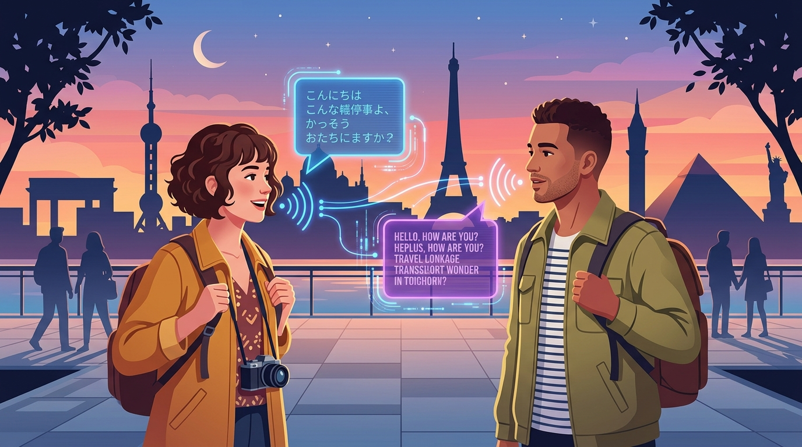
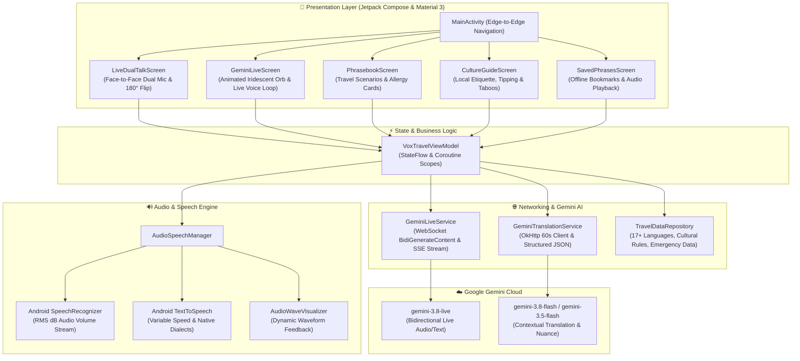
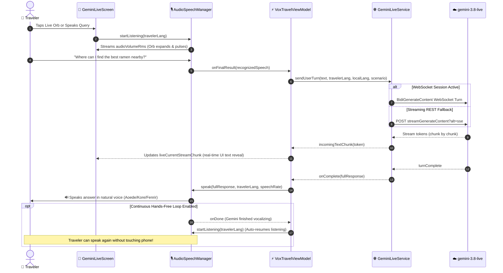
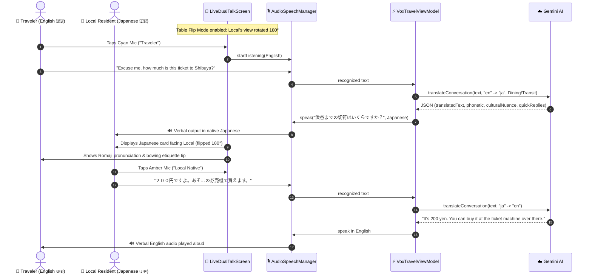

# ✈️ VoxTravel — Real-Time Voice Translator & Gemini 3.8 Live Companion

<div align="center">
  
  
  <p align="center">
    <strong>A next-generation real-time voice interpreter, face-to-face dual conversation translator, and interactive travel companion powered by Gemini 3.8 Live API.</strong>
  </p>

  <p align="center">
    
    
    
    
  </p>
</div>

---

## 📖 Overview

**VoxTravel** is an Android application engineered for travelers traversing foreign countries. It breaks down language and cultural barriers through **live voice conversations** using the **Gemini 3.8 Live API**, **dual face-to-face table translation with 180° rotation**, **audible native text-to-speech**, **life-saving dietary allergy alert cards**, and **local cultural etiquette guides**.

---

## 🏛️ System Architecture

The following diagram illustrates the component architecture of VoxTravel:



---

## 🔄 Sequence Diagrams

### 1. Gemini 3.8 Live API Bidirectional Voice Conversation Flow

This diagram demonstrates how hands-free continuous voice interaction works with `gemini-3.8-live`:



---

### 2. Dual Face-to-Face Interpretation Flow with 180° Table Flip

This diagram illustrates how two people sitting across a table communicate in real time:



---

## 🌟 Feature Breakdown

### 1. 🎙️ Gemini 3.8 Live Voice Companion (`gemini-3.8-live`)
- **Full-Duplex Live Streaming**: Real-time bidirectional communication powered by `gemini-3.8-live` with fallback to `gemini-2.5-flash-native-audio-preview-12-2025` and `gemini-3.8-flash`.
- **Animated 3D Iridescent Orb**: A centerpiece visual asset that rotates, pulses, and scales with user speech RMS audio volume.
- **Hands-Free Conversational Loop**: Automatic continuous listening after Gemini finishes speaking for natural, hands-free conversation on the go.
- **Voice Persona Selection**: Choose from 5 voices (`Aoede`, `Kore`, `Fenrir`, `Puck`, `Charon`).
- **One-Tap Travel Shortcuts**: Situational prompts for ordering food, subway navigation, and cultural advice.

### 2. 👥 Face-to-Face Dual Conversation Interpreter
- **Dedicated Split Buttons**: High-contrast, color-coded buttons for Traveler (Cyan) and Local Native Speaker (Amber).
- **180° Table Flip Mode**: Rotates conversation bubbles upside-down so someone seated across a restaurant table or checkout counter can read in their orientation.
- **Dynamic Waveform Visualizer**: Visual audio bars that pulse with speech volume.
- **Phonetic Pronunciation Guides**: Romanized pronunciation (Romaji, Pinyin, phonetics) for non-Latin alphabets.
- **Cultural Nuance Badges**: Real-time etiquette advice for each turn (e.g., bowing in Japan, formal *usted* in Spanish, bread placement in France).
- **Smart Quick Replies**: Tap contextually suggested response chips to keep conversations moving.
- **Silent Input Fallback**: Dual-flag keyboard input for noisy transit stations or quiet museums.

### 3. 🚨 Dietary Allergy Warning & Travel Phrasebook
- **Full-Screen Emergency Cards**: High-contrast, large-text allergy warnings (Peanuts, Celiac/Gluten, Shellfish, Dairy, Vegetarian) formatted to hand directly to foreign waitstaff or chefs.
- **6 Travel Scenarios**: Transit & Directions (🚕), Dining & Allergies (🍜), Lodging & Hotels (🏨), Shopping & Markets (🛍️), Emergency & Medical (🚨), and Casual Chat (💬).
- **Instant Audio Pronunciation**: Tap any phrase for native speech synthesis.

### 4. 🏯 Cultural Etiquette & Destination Guides
- Country-specific etiquette guides for **Japan, France, Italy, Spain, South Korea, Thailand, Germany, and Mexico**.
- Comprehensive travel guidance on **Tipping Customs, Dining Manners, Transit Tips, Taboos to Avoid**, and **Local Emergency Numbers** (Police, Ambulance, Fire, Tourist Police).

### 5. ⭐ Bookmarked Offline Expressions
- Star and save any translated exchange for quick offline access and one-touch audio replay without network connectivity.

---

## 🛠️ Technology Stack

| Layer | Technologies |
|---|---|
| **Language** | Kotlin 2.2.10 |
| **UI Framework** | Jetpack Compose (BOM 2024.09.00), Material Design 3 (M3) |
| **AI Models** | `gemini-3.8-live` (Live API), `gemini-3.8-flash`, `gemini-3.5-flash` |
| **Networking** | OkHttp 4.10.0 (WebSocket & SSE Streaming), Retrofit 2.12.0, Moshi |
| **Audio & Speech** | Android `SpeechRecognizer`, Android `TextToSpeech` (TTS) |
| **Architecture** | MVVM (Model-View-ViewModel), StateFlow, Coroutines |
| **Testing** | Robolectric 4.16.1, JUnit 4, Compose UI Test |
| **Secret Management** | Google Secrets Gradle Plugin + `.env` / `.env.example` |

---

## 📁 Project Structure

```
├── .env.example                               # Environment template for GEMINI_API_KEY
├── app/
│   ├── build.gradle.kts                       # App Gradle build configuration & dependencies
│   ├── src/
│   │   ├── main/
│   │   │   ├── AndroidManifest.xml            # Manifest declarations & audio permissions
│   │   │   ├── java/com/example/
│   │   │   │   ├── MainActivity.kt            # Root Activity & navigation scaffolding
│   │   │   │   ├── audio/
│   │   │   │   │   └── AudioSpeechManager.kt  # STT (SpeechRecognizer) & TTS engine
│   │   │   │   ├── data/
│   │   │   │   │   ├── api/
│   │   │   │   │   │   ├── GeminiLiveService.kt        # WebSocket & SSE Live API client
│   │   │   │   │   │   └── GeminiTranslationService.kt # Direct REST structured translator
│   │   │   │   │   ├── model/
│   │   │   │   │   │   └── TravelModels.kt             # Language, Scenario, and Result models
│   │   │   │   │   └── repository/
│   │   │   │   │       └── TravelDataRepository.kt     # Phrasebook & Country etiquette dataset
│   │   │   │   ├── ui/
│   │   │   │   │   ├── components/
│   │   │   │   │   │   ├── AudioWaveVisualizer.kt      # Glowing audio wave visualizer
│   │   │   │   │   │   ├── ConversationItemView.kt     # Translation bubble with phonetics
│   │   │   │   │   │   ├── DietaryAllergyDialog.kt     # Fullscreen allergy emergency card
│   │   │   │   │   │   └── LanguageSelectorDialog.kt   # Searchable language selector
│   │   │   │   │   ├── screens/
│   │   │   │   │   │   ├── LiveDualTalkScreen.kt       # Dual face-to-face interpreter screen
│   │   │   │   │   │   ├── GeminiLiveScreen.kt         # Gemini 3.8 Live audio orb screen
│   │   │   │   │   │   ├── PhrasebookScreen.kt         # Categorized phrasebook & allergy cards
│   │   │   │   │   │   ├── CultureGuideScreen.kt       # Country etiquette & customs guide
│   │   │   │   │   │   └── SavedPhrasesScreen.kt       # Bookmarked conversations
│   │   │   │   │   ├── theme/
│   │   │   │   │   │   ├── Color.kt                    # Midnight navy & neon accent palette
│   │   │   │   │   │   ├── Theme.kt                    # Material 3 dynamic & dark themes
│   │   │   │   │   │   └── Type.kt                     # Typography configuration
│   │   │   │   │   └── viewmodel/
│   │   │   │   │       └── VoxTravelViewModel.kt       # Main StateFlow view model
│   │   │   └── res/
│   │   │       ├── drawable/                           # App icon and hero banner visual assets
│   │   │       ├── mipmap-*/                           # Adaptive PNG launcher icons across all densities
│   │   │       └── values/strings.xml                  # App strings ("VoxTravel")
│   │   └── test/java/com/example/
│   │       └── ExampleRobolectricTest.kt              # Robolectric tests for app & Gemini Live
└── metadata.json                              # AI Studio application metadata
```

---

## 🚀 Setup & Execution

### 1. API Key Configuration
1. Open the **Secrets panel in Google AI Studio**.
2. Add your key with the variable name `GEMINI_API_KEY`.
3. The build system injects this into `BuildConfig.GEMINI_API_KEY` at compile time via the Secrets Gradle Plugin.

### 2. Required Permissions
Declared in `AndroidManifest.xml`:
- `android.permission.INTERNET`: For Gemini Live API and REST communications.
- `android.permission.RECORD_AUDIO`: Runtime permission for microphone audio input.
- `android.permission.MODIFY_AUDIO_SETTINGS`: For adjusting speech audio playback volume and routing.

### 3. Running Unit Tests
To run local JVM Robolectric unit tests:
```bash
gradle :app:testDebugUnitTest
```

---
